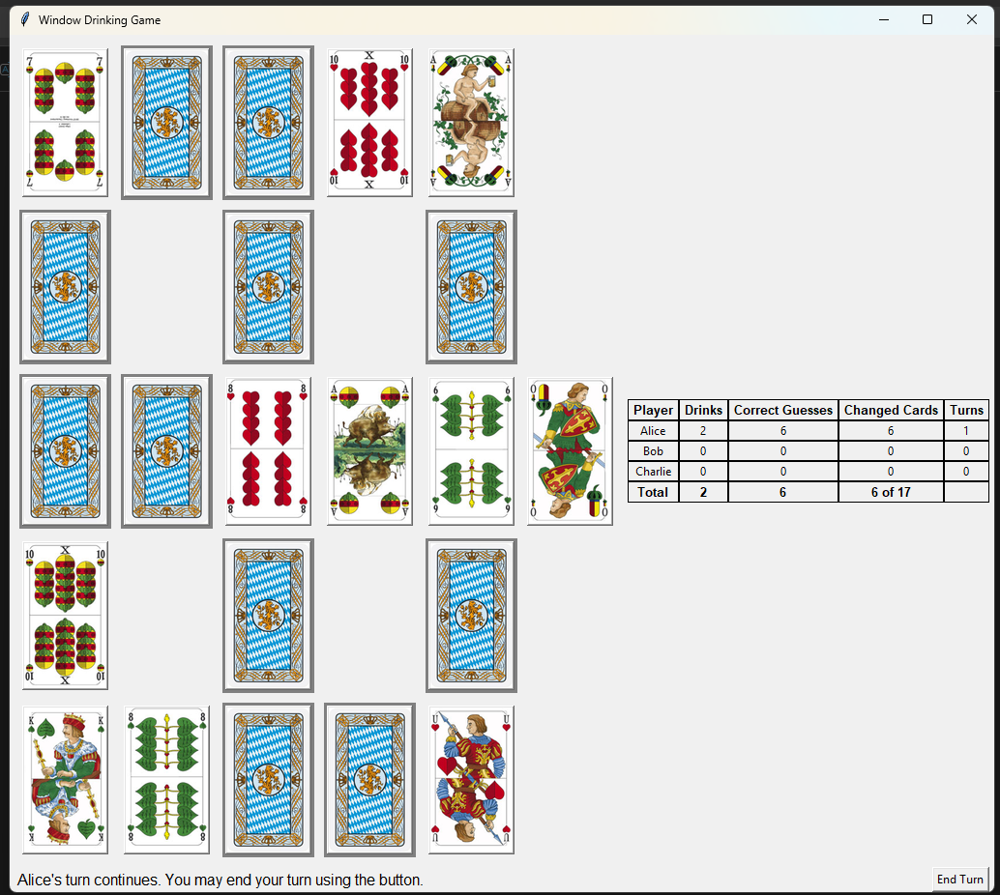

# Window - a German drinking game



This project's purpose is the:
- Development of the basic functionality of the German "Window" drinking game
- The creation of methods to predict the next best move, via
   - The training of a DRL-Agend
   - The development of a pure statistical method

**Window** is a cross-platform implementation of the German Window drinking
card game. Play locally on one device, host an online room for friends, or ask
the app for an advisory next-move proposal. The installed Flutter app targets
Android smartphones and PC/laptops running Linux or Windows. Friends can also
join an app-hosted game in their browser without installing anything. iOS
project files remain in the repository, but iOS is outside the current support scope.

> Play responsibly, use non-alcoholic alternatives whenever appropriate, and
> never pressure anyone to drink.

## What you can do

- Start an offline game with any non-empty list of player names.
- Create or join a Firebase-backed online room with a six-character code.
- Join from an installation-free browser client served by Firebase Hosting.
- Register one or more players sharing an installed app or browser device.
- Play the complete Window ruleset: handle moves, passes, redeals, and
  same-rank confirmations.
- Use **Propose best move** for an advisory model/heuristic suggestion. It
  never plays a move automatically.
- Train and deploy a replacement ONNX policy with the GPU-native RL pipeline.

## Run on a PC/laptop or smartphone

Install the [Flutter SDK](https://docs.flutter.dev/get-started/install) and
platform tooling. On Ubuntu, install the Linux desktop build prerequisites:

```bash
sudo apt install clang cmake ninja-build pkg-config libgtk-3-dev libstdc++-12-dev
```

From the repository root:

```bash
cd app
flutter pub get
flutter test
flutter run -d linux --dart-define-from-file=../firebase-options.json
```

For a Windows PC/laptop, select its `windows` target. For Android, install the
Android SDK, connect a device or start an emulator, then use the device ID from
`flutter devices`:

```bash
flutter run -d YOUR_ANDROID_DEVICE_ID --dart-define-from-file=../firebase-options.json
flutter build apk --release --dart-define-from-file=../firebase-options.json
```

The Linux runner is included. Local play also works without Firebase: omit the
`--dart-define-from-file` argument. To distribute a desktop app, build with
`flutter build linux` on Linux or `flutter build windows` on Windows, passing
that same configuration argument. Keep the entire generated desktop bundle
together when distributing it.

On Linux, the app prefers X11 (or XWayland in a Wayland desktop session) to
avoid GTK crashes when legacy GNOME font-settings keys are unavailable. This
choice only affects the app; native Wayland remains a fallback when X11 is
unavailable. An explicit `GDK_BACKEND` setting still takes precedence. If your
shell forces Wayland and you see an `xsettings` / `antialiasing` startup error,
run with `GDK_BACKEND=x11` before the `flutter run` command.

## Firebase multiplayer and browser joining

Online rooms require Firebase Anonymous Authentication and Realtime Database.
Enable Anonymous sign-in in Firebase Authentication, create the database, and
create a Git-ignored `firebase-options.json` in the repository root:

```json
{
  "FIREBASE_API_KEY": "...",
  "FIREBASE_WEB_API_KEY": "...",
  "FIREBASE_PROJECT_ID": "your-project-id",
  "FIREBASE_DATABASE_URL": "https://your-database-url"
}
```

The HTTPS connection accepts either API-key field on installed apps; a separate
Android app ID is not required for this connection. After changing the build
configuration, stop the app and run it again with the configuration argument;
hot reload does not update these settings.

Use the same Firebase project for all installed and browser builds. Additional
existing Firebase configuration keys may remain in this file. Optionally set
`WINDOW_BROWSER_URL` to the actual browser address when using a custom domain
or a Hosting site whose name differs from the project ID; otherwise the app
displays `https://YOUR_PROJECT_ID.web.app`.

Deploy the database rules once (or when changing them):

```bash
npx firebase-tools login
npx firebase-tools deploy --only database --project YOUR_PROJECT_ID
```

### Publish the browser client

Firebase Hosting serves the release files while Firebase Realtime Database
connects the host and players. No Flutter development server, laptop, or
Cloudflare tunnel needs to run during a smartphone-hosted game.

Room state and move requests use Firebase's live change stream on Android,
Linux, Windows, and browsers. Updates arrive without the previous 700 ms polling
timers; the host still validates each move. Private and public state publish
together in one atomic update. Connections retry after interruptions and refresh
expired sign-in credentials. Network latency still affects delivery. Keep the
host app open during a game, especially on a smartphone. Cursor sharing is not
included.

From the repository root, build and deploy the browser client:

```bash
python3 tools/browser.py deploy
```

The helper reads the local Firebase configuration, builds the Flutter guest
client, and deploys **only Hosting** to that project. A Firebase CLI login,
Node.js/npm, Python 3, and Flutter are required. Build without publishing with:

```bash
python3 tools/browser.py build
```

After a successful deployment, the browser client is available at
`https://YOUR_PROJECT_ID.web.app` (also `https://YOUR_PROJECT_ID.firebaseapp.com`).
Rebuild and publish it when updating the game. The browser interface only
joins rooms; local play and lobby creation belong to the installed apps.

### Host and guest flow

1. Open the installed smartphone or PC/laptop app, enter the players sharing
   that device, and choose **Create online lobby**.
2. Share the six-character room code outside the app. For browser guests,
   also share the browser address displayed in the lobby; **Copy browser
   address** copies the stable URL.
3. Guests either enter that code in their installed app or open the website
   on their phone or PC/laptop. Enter one or more player names separated by
   commas, then choose **Join online room**. Names must be unique in the lobby.
4. Once everyone appears in the lobby, the host chooses **Start game and lock
   lobby**. New players cannot join after this point.

The room creator is the trusted host: it validates moves and retains the deck
and face-down card identities. Guests receive the public board and submit
requests only for seats owned by their device. Keep the host app open and
connected during play. Refresh/restart behavior remains unchanged: anonymous
identity is held in memory, so refreshing or restarting does not recover the
previous seat. Optional links ending in `?room=ABC234` prefill the room code;
guests still enter their names and explicitly join.

## Documentation

- [Game rules](GAME_README.md) — setup, valid guesses, redeals, and scoring.
- [Statistics adviser](STATISTICS_README.md) — public-history beliefs, bounded simulations, and explanations.
- [ML development](ML_README.md) — CUDA training, evaluation, export, and
  deployment.
- [ML agent specification](ml/ml_move_prediction_plan.txt) — target,
  information restrictions, contract, and acceptance criteria.

## Repository map

| Location | Purpose |
| --- | --- |
| `app/` | Flutter application for all player-facing platforms. |
| `app/lib/game_engine.dart` | Canonical rules, independent of UI and networking. |
| `app/lib/main.dart` | Responsive local and online game interface. |
| `app/lib/firebase_room_repository.dart` | Host-authoritative Firebase room transport. |
| `app/lib/rl_policy.dart` | ONNX inference, legal-action masking, and fallback suggestions. |
| `app/assets/` | Card artwork and bundled ONNX policy. |
| `app/test/` | Game-engine, policy, browser entry, and lobby transport tests. |
| `tools/browser.py` | Build and publish the browser guest client to Firebase Hosting. |
| `ml/` | GPU-native masked-PPO trainer, simulator, and ONNX exporter. |
| `firebase-database.rules.json` | Firebase Realtime Database access rules. |
| `resources/docs/` | Documentation imagery. |

## Current model status

`app/assets/models/window_policy.onnx` is deliberately untrained and verifies
only packaging and inference. Until a trained policy is exported, the app
labels its proposal accordingly. Pure statistics is independently selectable
and also handles unavailable models or inference failures.
