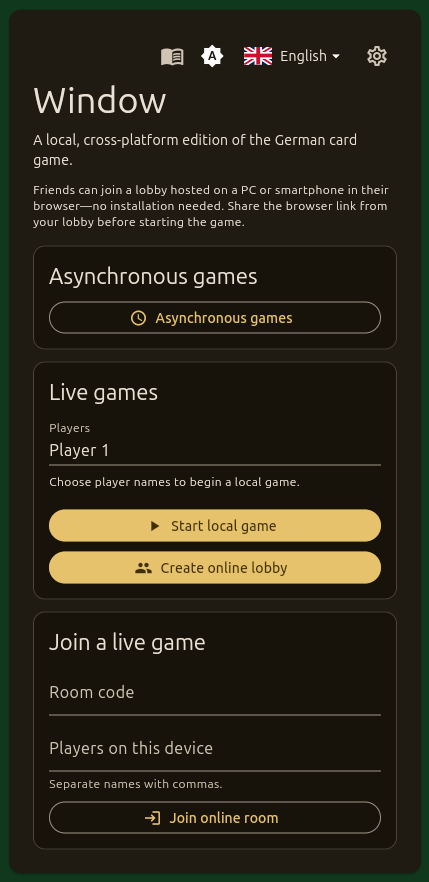
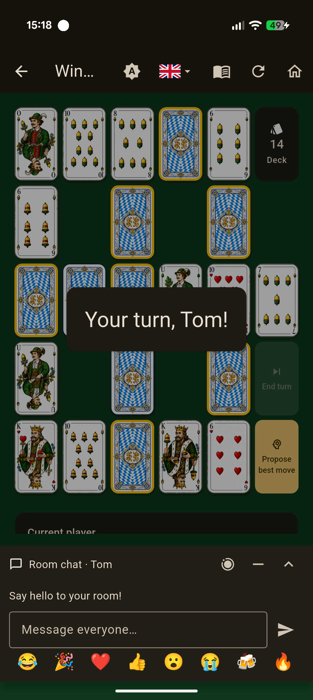
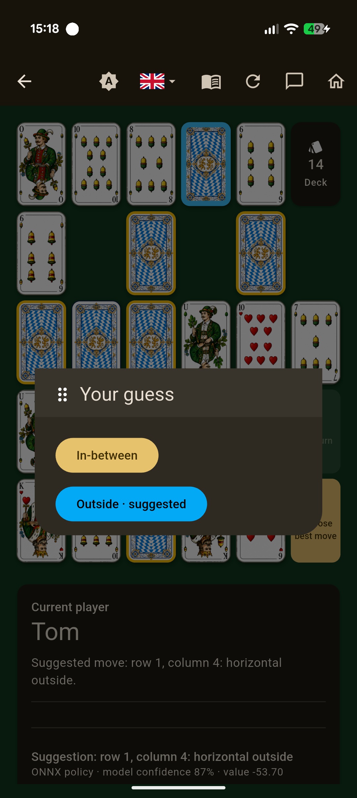
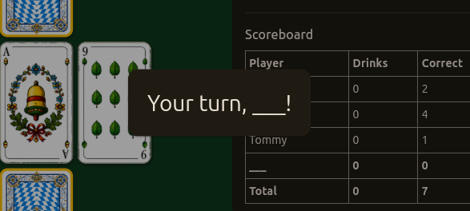

# Window - a German drinking game


This project's purpose is the:
- Development of the basic functionality of the German _Window_ drinking game
- The creation of methods to predict the next best move, via
   - The training of a DRL-Agend
   - The development of a pure statistical method

**Window** is a cross-platform implementation of the German _Fenster_ drinking
card game. Play locally on one device alone or together, host an online room for friends or play together asynchronously. It is possible to use the project directly on Linux and Windows, or as an installed app on Android. Furthermore it is possible to join an existing lobby via the browser without installing anything.

> Play responsibly, use non-alcoholic alternatives whenever appropriate, and
> never pressure anyone to drink.

## General description

Play **Window** on Android, Linux, or Windows. Friends can also join through the
[browser](https://window-game.web.app) without installing the app.

- **Local:** play on one device, alone or with friends.
- **Live:** host or join an online room and play together in real time.
- **Asynchronous:** join a saved game and take turns whenever you have time.
  Enable turn notifications on Android or a supported browser.

<p align="center">
  
  
</p>

Online games include chat and emoji reactions. Need help choosing a move? The
app can suggest one using a statistical adviser or a trained RL model; you make
the final choice. See the [game rules](GAME_README.md) for how to play.

<p align="center">
  
  
  
</p>

## Installation

- **Android:** Install a shared APK, or build one with the commands below and
  copy `app/build/app/outputs/flutter-apk/app-release.apk` to your phone and
  open it. Allow
  installation from the source if Android asks. The APK is not included in the
  repository.
- **Linux or Windows:** Install [Flutter](https://docs.flutter.dev/get-started/install)
  and the platform prerequisites, then run the app with the commands below.
- **Browser:** Open the [game](https://window-game.web.app); no installation is
  needed.

From the repository root, with Flutter and the relevant platform SDK installed:

```bash
cd app
flutter pub get
flutter run -d linux   # use -d windows on Windows
# Or build the Android APK:
flutter build apk --release --dart-define-from-file=../firebase-options.json
```

For online play, configure `firebase-options.json` using
[firebase-options.example.json](firebase-options.example.json) and pass
`--dart-define-from-file=../firebase-options.json` to `flutter run` as well.
Before building for Android, run `python3 tools/configure_async_notifications.py`
from the repository root to generate the notification configuration. Local
play does not require this configuration.

## Now its YOUR turn



# Development

- [Game rules](GAME_README.md) — setup, valid guesses, redeals, and scoring
- [Statistics adviser](STATISTICS_README.md) — public-information probabilities,
  move proposals, and history evaluation
- [ML development](ML_README.md) — CUDA training, evaluation, export, and
  deployment
- [ML agent specification](ml/ml_move_prediction_plan.txt) — target,
  information restrictions, contract, and acceptance criteria

## Repository map

| Location | Purpose |
| --- | --- |
| `app/` | Flutter application for all player-facing platforms |
| `app/lib/game_engine.dart` | Canonical rules, independent of UI and networking |
| `app/lib/main.dart` | Responsive local and online game interface. |
| `app/lib/firebase_room_repository.dart` | Host-authoritative Firebase room transport |
| `app/lib/rl_policy.dart` | ONNX inference, legal-action masking, and explicit adviser errors |
| `app/lib/statistics/` | Runtime statistics adviser, public-card beliefs, and player models |
| `app/assets/` | Card artwork and bundled ONNX policy |
| `app/test/` | Game-engine, policy, browser entry, and lobby transport tests |
| `tools/browser.py` | Build and publish the browser guest client to Firebase Hosting |
| `ml/` | GPU-native masked-PPO trainer, simulator, and ONNX exporter |
| `statistics/` | Statistics evaluation tools, headless experiments, and supporting findings |
| `firebase-database.rules.json` | Firebase Realtime Database access rules |
| `resources/docs/` | Documentation imagery |
