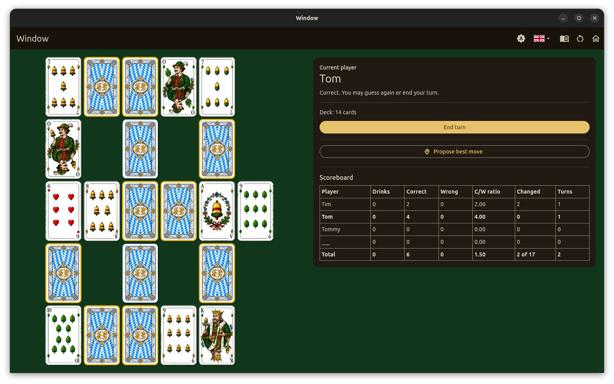
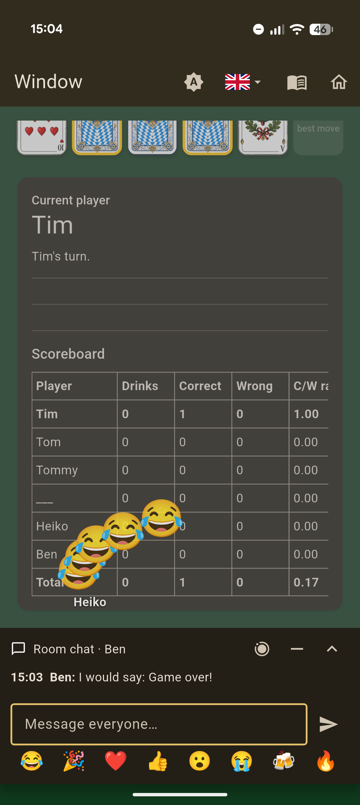
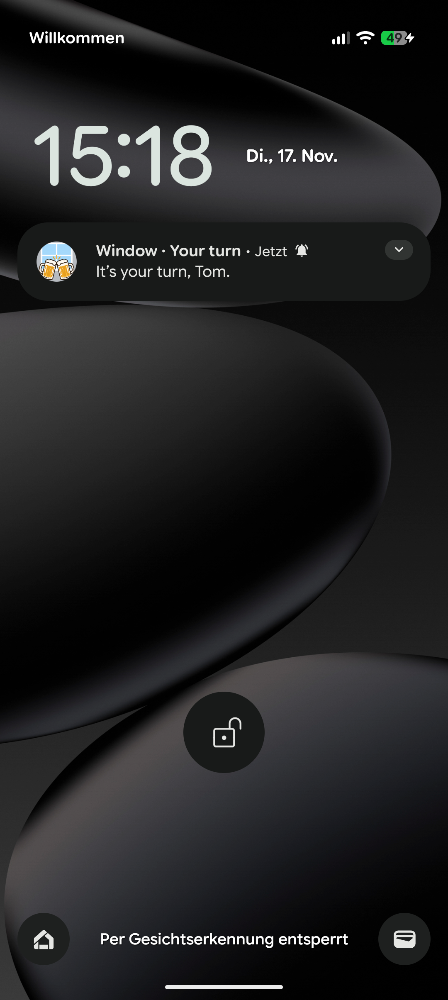

# Window - a German drinking game



This project's purpose is the:
- Development of the basic functionality of the German _Window_ drinking game
- The creation of methods to predict the next best move, via
   - The training of a DRL-Agend
   - The development of a pure statistical method

**Window** is a cross-platform implementation of the German _Fenster_ drinking
card game. Play locally on one device alone or together, host an online room for friends or play together asynchronously. It is possible to use the project directly on Linux and Windows, or as an installed app on Android. Furthermore it is possible to join an existing lobby via the browser without installing anything.

> Play responsibly, use non-alcoholic alternatives whenever appropriate, and
> never pressure anyone to drink.

## General description

Play **Window** on Android, Linux, or Windows. Friends can also join through the
[browser](https://window-game.web.app) without installing the app.

- **Local:** play on one device, alone or with friends.
- **Live:** host or join an online room and play together in real time.
- **Asynchronous:** join a saved game and take turns whenever you have time.
  Enable turn notifications on Android or a supported browser.

<p align="center">
  
  
</p>

Online games include chat and emoji reactions. Need help choosing a move? The
app can suggest one using a statistical adviser or a trained RL model; you make
the final choice. See the [game rules](GAME_README.md) for how to play.

<p align="center">
  
  
  
</p>

## Installation

- **Android:** Install a shared APK, or build one with the commands below and
  copy `app/build/app/outputs/flutter-apk/app-release.apk` to your phone and
  open it. Allow installation from the source if Android asks. The APK is not included in the
  repository.
- **Linux or Windows:** Install [Flutter](https://docs.flutter.dev/get-started/install)
  and the platform prerequisites, then run the app with the commands below.
- **Browser:** Open the [game](https://window-game.web.app); no installation is
  needed.

From the repository root, install dependencies and start the app on Linux:

```bash
cd app
flutter pub get
flutter run -d linux
```

On Windows, use the same first two commands, then run:

```bash
flutter run -d windows
```

For online play, configure `firebase-options.json` using
[firebase-options.example.json](firebase-options.example.json) and add
`--dart-define-from-file=../firebase-options.json` to the `flutter run` command.
Local play does not require this configuration.

To build the Android APK, first run `python3 tools/configure_async_notifications.py`
from the repository root, then run from `app/`:

```bash
flutter build apk --release --dart-define-from-file=../firebase-options.json
```

## Now its YOUR turn


# Development

- [Game rules](GAME_README.md) — setup, valid guesses, redeals, and scoring
- [Statistics adviser](STATISTICS_README.md) — public-information probabilities,
  move proposals, and history evaluation
- [ML development](ML_README.md) — CUDA training, evaluation, export, and
  deployment
- [ML agent specification](ml/ml_move_prediction_plan.txt) — target,
  information restrictions, contract, and acceptance criteria

## Configuration for online play

Local play needs no online configuration. For live rooms, create a Firebase
project, enable **Anonymous** sign-in under Authentication, and create a
Realtime Database. Register an Android app with package name
`com.timss.window.window_game` and a web app in the same Firebase project.
Copy the example in the repository root and fill in the local file:

```bash
cp firebase-options.example.json firebase-options.json
```

| Key | Value and purpose |
| --- | --- |
| `FIREBASE_PROJECT_ID` | Firebase project ID, from project settings. |
| `FIREBASE_API_KEY` | Android Firebase API key; also usable by the installed apps for live rooms. |
| `FIREBASE_WEB_API_KEY` | Web app's API key, from its Firebase configuration. |
| `FIREBASE_ANDROID_APP_ID` | Android Firebase app ID, from the registered Android app; used for notifications. |
| `FIREBASE_WEB_APP_ID` | Firebase app ID of the registered web app; used for browser notifications. |
| `FIREBASE_MESSAGING_SENDER_ID` | Firebase Cloud Messaging sender ID, from project settings. |
| `FIREBASE_DATABASE_URL` | Full Realtime Database URL, from the database console; used for live rooms. |
| `FIREBASE_AUTH_DOMAIN` | Firebase web app's auth domain; retained in the example but not currently read by the app. |
| `FIREBASE_VAPID_KEY` | **Public** Web Push certificate key from Firebase Cloud Messaging; needed for browser notifications. |
| `WINDOW_ASYNC_URL` | HTTPS address of the deployed Cloudflare Worker; used for asynchronous games. |

Optionally add `WINDOW_BROWSER_URL` if the browser client uses a custom address;
otherwise invitations use `https://<FIREBASE_PROJECT_ID>.web.app`. Use the same
Firebase project across builds. Live rooms need the database and an API key;
asynchronous games additionally need the Worker. Notification setup requires
the Firebase app and messaging values for the target platform. Set only real
values rather than leaving example placeholders in a build.

Build settings are embedded at compile time. After editing the file, restart
`flutter run` or rebuild with `--dart-define-from-file=../firebase-options.json`;
hot reload alone does not update them. Deploy the supplied database rules for
live rooms after reviewing them:

```bash
npx firebase-tools login
npx firebase-tools deploy --only database --project YOUR_PROJECT_ID
```

For asynchronous games, copy `backend/wrangler.example.jsonc` to
`backend/wrangler.jsonc`, set `BROWSER_URL` to the hosted browser address, and
deploy the Worker as described in [backend/README.md](backend/README.md). That
guide also covers the Durable Object bindings, the private admin key, and the
FCM service-account secret needed for turn notifications. `firebase.json`
defines Hosting and database rules; `firebase.emulator.json` configures the
local database emulator.

The client Firebase identifiers and public VAPID key are included in builds;
they are not server credentials. Keep service-account JSON, admin keys, and
recovery codes out of client configuration and Git. The local configuration
files, secrets, and generated notification resources are Git-ignored. For local
Worker testing only, use `backend/.dev.vars.example` as a template for
`backend/.dev.vars`; production secrets belong in the Worker secret store.

## Small Android APK for sharing

The ARM64 build contains only the libraries for `arm64-v8a`, making it smaller
than the universal APK. It works on ARM64 Android devices, but not on 32-bit or
x86-only devices. Install Flutter, the Android SDK, and Python 3, then run from
the repository root after configuring `firebase-options.json`:

```bash
python3 tools/configure_async_notifications.py
cd app
flutter pub get
flutter build apk --release --target-platform android-arm64 --dart-define-from-file=../firebase-options.json
```

Share `app/build/app/outputs/flutter-apk/app-release.apk`. The generation script
creates public Android and web notification resources; it does not include the
server's private FCM credential. For offline-only play, skip the generation script and omit the configuration
argument; online play and notifications require the configured build above.
To support other Android architectures in one file, omit
`--target-platform android-arm64` and build a universal APK instead.

Release builds currently use the local **debug signing key**. An APK can update
an existing installation only when their signing keys match; use a private
release keystore for wider distribution and keep it backed up. See the
[Flutter signing guide](https://docs.flutter.dev/deployment/android#sign-the-app).
APKs are Git-ignored and must be built or shared separately.

## Repository map

| Location | Purpose |
| --- | --- |
| `app/` | Flutter application for all player-facing platforms |
| `app/lib/game_engine.dart` | Canonical rules, independent of UI and networking |
| `app/lib/main.dart` | Responsive local and online game interface. |
| `app/lib/firebase_room_repository.dart` | Host-authoritative Firebase room transport |
| `app/lib/rl_policy.dart` | ONNX inference, legal-action masking, and explicit adviser errors |
| `app/lib/statistics/` | Runtime statistics adviser, public-card beliefs, and player models |
| `app/assets/` | Card artwork and bundled ONNX policy |
| `app/test/` | Game-engine, policy, browser entry, and lobby transport tests |
| `tools/browser.py` | Build and publish the browser guest client to Firebase Hosting |
| `ml/` | GPU-native masked-PPO trainer, simulator, and ONNX exporter |
| `statistics/` | Statistics evaluation tools, headless experiments, and supporting findings |
| `firebase-database.rules.json` | Firebase Realtime Database access rules |
| `resources/docs/` | Documentation imagery |
